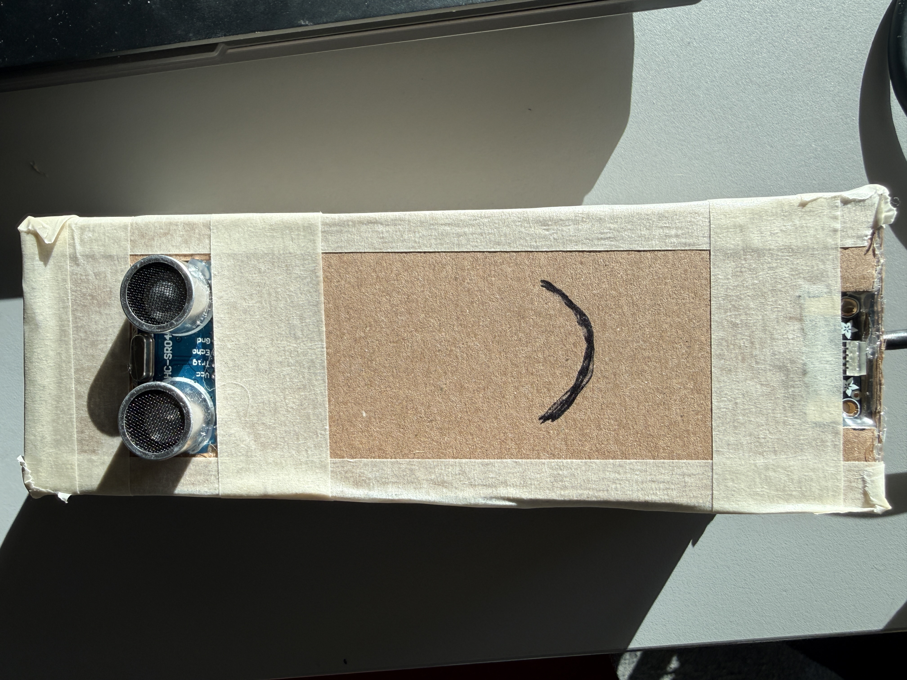
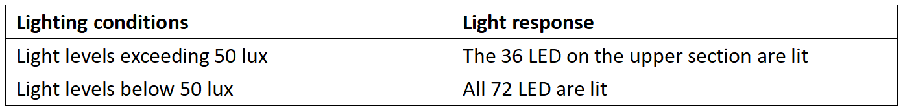
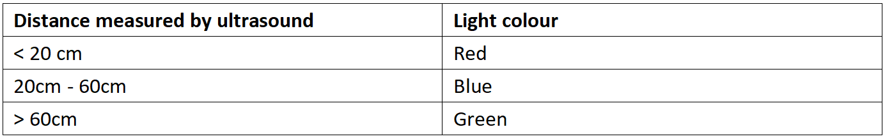
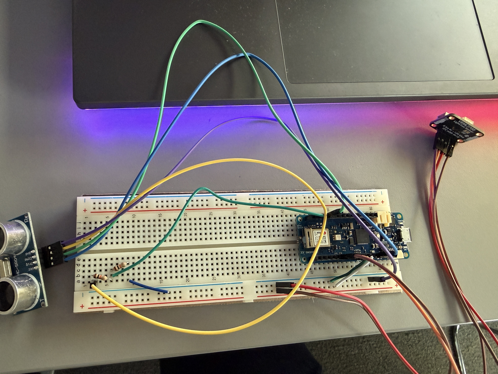
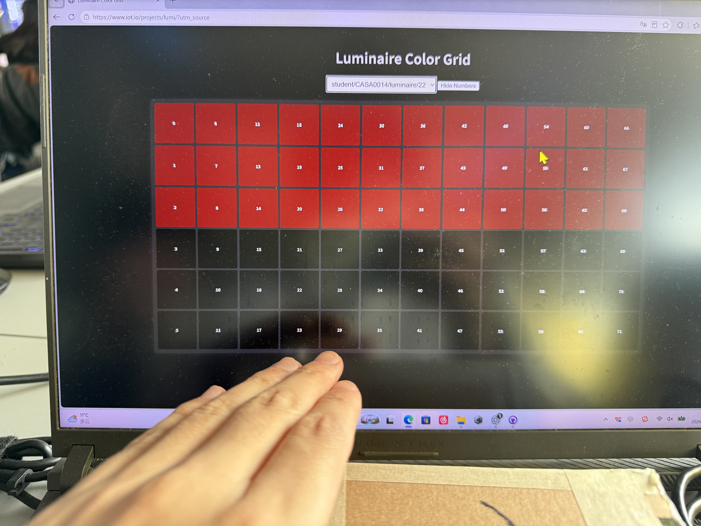
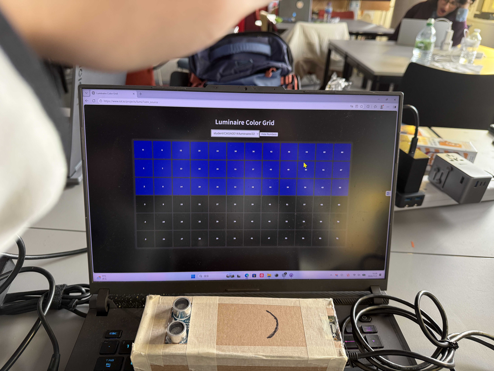
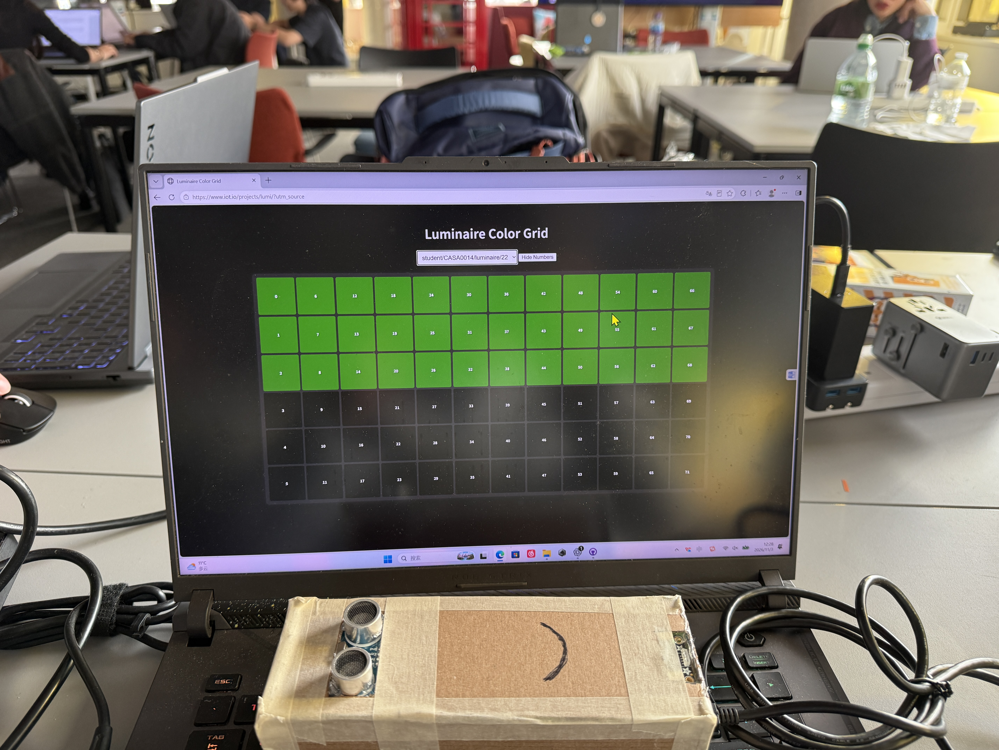
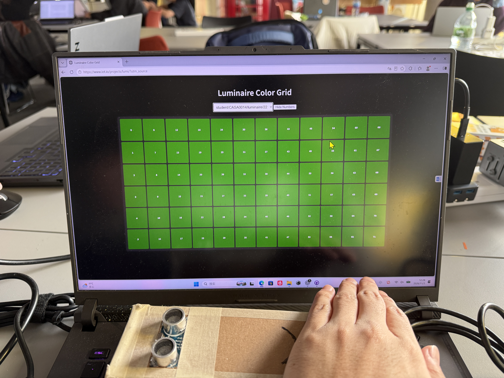

# Minion Light Controller
This is an Arduino-based physical lighting interaction prototype.
It uses a light sensor and an ultrasonic distance sensor, together
with Wi-Fi and MQTT, to control the Vespera lighting installation
in the laboratory.

**Final version: V2. Please use the code in [code/V2](code/V2).** 

## 1. Project Overview and Design Inspiration
The inspiration for this project came from a streetlight sensor I spotted by the roadside. It appeared to be designed to detect ambient light levels, which gave me an idea: could I build my own device that automatically adjusts its brightness according to the surrounding light conditions?

Building on this, I added an ultrasonic distance sensor, hoping that the light would not only respond to changes in its surroundings but also alert me to nearby objects approaching by changing colour.As the final prototype of the controller resembled the Minions from the films, I named the device the ‘Minion Light Controller’.

## 2. Functions and Operation
The two sensors control different lighting attributes independently.
Both responses can occur at the same time.
### Ambient Light Control

### Distance Control

## 3. Key Components and Wiring
- Arduino MKR WiFi 1010
- VEML7700 light sensor
- HC-SR04 ultrasonic distance sensor
- Breadboard and jumper wires
- Voltage-dividing resistors
- USB cable
- Cardboard enclosure

The following image shows a schematic diagram of the circuit connections.

## 4. System Workflow
1. The sensors measure ambient light and distance.
2. The Arduino determines the LED count and colour.
3. It publishes RGB data to the MQTT broker over Wi-Fi.
4. The Vespera lighting installation receives the data and updates
   its LEDs.

## 5. Setup and Operation
1. Assemble the circuit according to the wiring instructions.
2. In the Arduino IDE, select **Arduino MKR WiFi 1010**.
3. Install **WiFiNINA**, **PubSubClient** and **Adafruit VEML7700**,
   together with their required dependencies.
4. Create `arduino_secrets.h` and enter your own Wi-Fi and MQTT credentials.
5. Open the **V2** sketch and check the light ID and MQTT topic
   before uploading.
6. Open the Serial Monitor at **115200 baud** to view the light
   level, distance and lighting state.

## Test Results
The following photographs show the output displayed by the
Luminaire Color Grid during testing.

